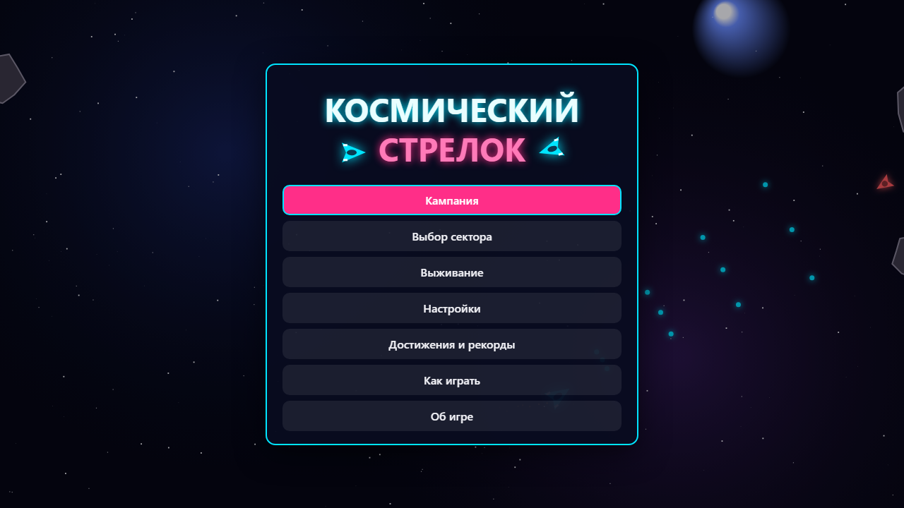
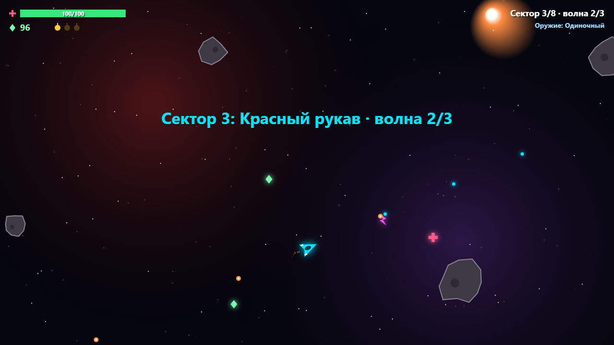
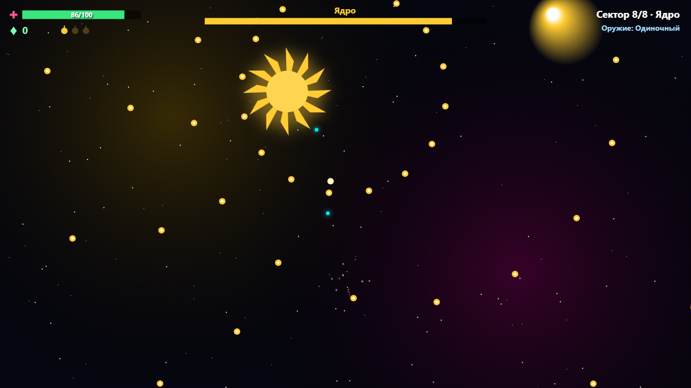

<div align="center">

# SpaceGun - Космический стрелок

**Космический стрелок - космическая стрелялка с видом сверху на одной HTML-странице: волны кораблей и астероидов, боссы и мастерская между секторами. Работает в браузере без сервера и без интернета: откройте `index.html` или играйте онлайн.**

[**▶ Играть онлайн →**](https://alexalesha.github.io/SpaceGun/) &nbsp;·&nbsp; [English version of this file](README.md)

[](#) [](LICENSE) [](https://developer.mozilla.org/docs/Web/HTML) [](https://alexalesha.github.io/SpaceGun/) [](https://claude.com/claude-code)

Код, тесты и документация этого проекта написаны Claude (Anthropic) в Claude Code. Идеи, проверка и решения - Алексей.

</div>

> Фанатская игра. Корабли, взрывы и туманности нарисованы кодом.







## Что есть в игре

- **Кампания из 8 секторов:** в каждом несколько волн, в конце - элитное звено или босс (Страж, Рой-матка, крейсер «Гроза», Ядро).
- **Мастерская** после сектора: за кредиты улучшаются оружие, урон, броня, двигатели и скорострельность, есть ремонт и бомбы.
- **Выживание:** волны без конца, оружие улучшается само каждые 3 волны.
- Снайперы сначала показывают линию выстрела, крейсер и Ядро - лучи: уйдите с линии, пока она пунктирная.
- Достижения и рекорды, настройки с автоприцелом, геймпад; музыка и звуки синтезируются WebAudio.

## Управление

| Клавиша | Действие |
|---|---|
| WASD или стрелки | полёт |
| Мышь | прицел |
| ЛКМ или Пробел | огонь |
| E | бомба |
| Esc | пауза |

Где игра это позволяет, клавиши меняются в настройках.

## Запуск у себя

Откройте `index.html` в Chrome, Edge или Firefox. Всё лежит в репозитории, ничего не скачивается.

## Проверки

Законы - проверки Playwright в `tests/`. Они открывают страницу по файловому адресу в безголовом
Chromium, по одной за раз:

```
npm install
npx playwright install chromium
npm test
```

Захват мыши в проверках всегда поддельный: настоящий `requestPointerLock` в безголовом Chromium
на Windows может зажать курсор пользователя.
Кадры выше сняты в безголовом браузере скриптом кадров сборника Hub.

## История

Игра сделана в сборнике [Hub](https://github.com/ALEXalesha/ALEXalesha.github.io) (папка `web/space_shooter`), там она же работает в Хабе ([играть там](https://alexalesha.github.io/)). Здесь игра лежит вместе с историей коммитов.

## Лицензия

MIT, см. [LICENSE](LICENSE).
